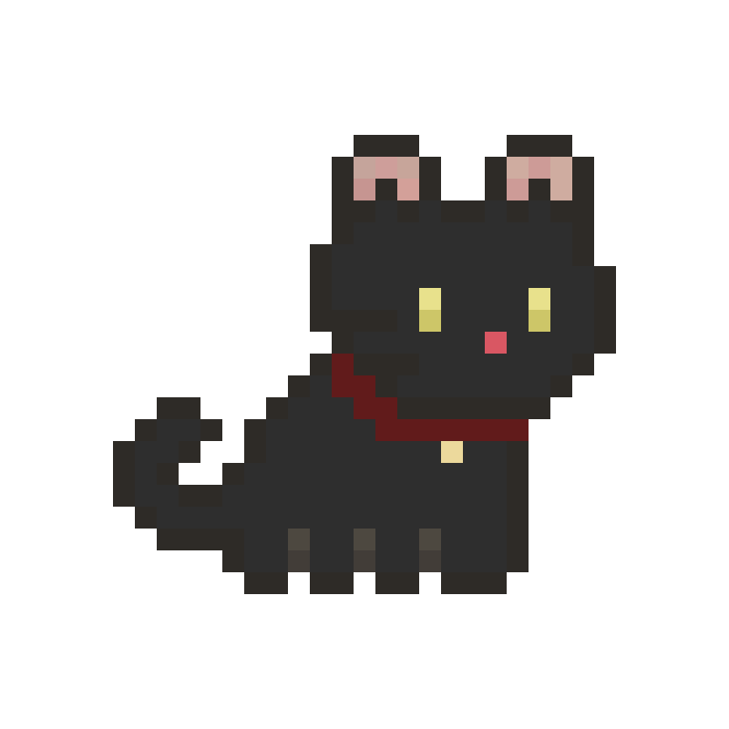

<div align="center">


<br/><br/>


# Kiko

**A little cat. A big personality.**

A tiny animated desktop companion that lives on your macOS desktop.

Kiko walks, sleeps, plays, follows your cursor, discovers cardboard boxes and occasionally gets zoomies.

<br/>

[](https://apple.com/macos)
[](https://swift.org)
[](LICENSE)
[](#building--running)

</div>

---

## Features

### Desktop Integration
- **Transparent Floating Panel:** Runs as a non-activating, borderless `NSPanel` at the floating window level.
- **Multi-Display Aware:** Seamlessly traverses all connected screens, respecting macOS Menu Bar and Dock boundaries.
- **Battery Efficient:** Low CPU draw (under 0.5% idle) by utilizing display link throttling and stationary back-offs.

### Application Window and Title-Bar Interaction
- **Real-Time Window Detection:** Polls the macOS Window Server via CoreGraphics to detect visible on-screen application windows.
- **Title-Bar Perching:** Kiko detects window header edges and hops up to sit, loaf, or balance-walk along active window frames.
- **Window Movement Tracking:** If an application window moves or closes while Kiko is perched on it, gravity physics trigger a smooth jump down to the desktop.

### Autonomous Behaviour Engine
- **State Machine:** Fluid autonomous transitions between Sitting, Idling, Walking, Running, Jumping, Attacking, Stalking, Sleeping, and Zoomies.
- **Continuous Need Meters:** Dynamically evaluates internal Energy, Boredom, Affection, and Hunger.
- **Random Desktop Events:** Spontaneous cardboard box dives, dramatic flops, midnight zoomies, and window watching.

### Cursor Interaction and Petting
- **Curious Follower:** Creeps toward the mouse cursor when curiosity is high, stopping at a polite distance.
- **Scruff Drag and Drop:** Click and drag Kiko to pick him up by the scruff; release to drop with realistic gravity and terminal velocity.
- **Petting and Purrs:** Clicking and petting raises affection and happiness meters, triggering gentle purrs.

### Cardboard Box and Bed System
- **Interactive Box and Cushion:** Spawn a cardboard box or plush donut bed anywhere on the desktop.
- **Autonomous Nesting:** When sleepy or bored, Kiko walks over, climbs inside, peeks over the rim, and curls up for a nap.

### Mini-Games and Toys
- **Laser Pointer:** High-intensity red laser dot that follows cursor; cat energetically chases and pounces on it.
- **Yarn Ball:** Bouncing yarn ball with real-time physics (velocity, gravity, restitution); cat bats it around the screen.
- **Fish Treat:** Drop a savory fish snack on the desktop for the cat to stalk, eat, and purr.

### Cat Avatars
- **Kiko (Black Cat):** Sleek midnight black cat with golden glowing eyes, swift reflexes, and playful stealth (Default).
- **Multiple Breeds:** Ginger, Calico, White Cat (Mochi), Brown Cat, Siamese, Tiger, Astronaut, Batcat, Demon, Santa, Vampire, and Witch.

### Audio System
- Procedural audio cues using native `NSSound` for purrs, meows, laser pounces, and yarn taps.

### Preferences and Status Bar Menu
- Clean menu bar item with quick controls to trigger zoomies, wake/sleep, switch avatars, and access full settings.

---

## Preview

<div align="center">



<p><em>Kiko the Black Cat, rendered in pixel-art fidelity.</em></p>

</div>

---

## Building and Running

### Prerequisites
- macOS 13.0 (Ventura) or newer (Sonoma and Sequoia supported)
- Apple Silicon or Intel Mac
- Swift 5.9+ / Command Line Tools or Xcode 15+

### Build from Command Line
```bash
# Clone the repository
git clone https://github.com/rtomswastaken/kiko-desktop-pet.git
cd kiko-desktop-pet

# Build the project
swift build

# Run Kiko
swift run Kiko

# Run unit tests
swift test
```

---

## Project Architecture

```
kiko-desktop-pet/
|
|-- README.md                      # Project overview and documentation
|-- LICENSE                        # MIT License and asset notices
|-- .gitignore                     # Swift, Xcode, and asset exclusion rules
|-- CONTRIBUTING.md                # Contribution guidelines
|-- CHANGELOG.md                   # Release history
|-- Package.swift                  # Swift Package Manager manifest
|
|-- assets/
|   |-- branding/                  # Repository identity
|   |   |-- kiko-avatar.png        # 512x512 Black Cat avatar
|   |   |-- kiko-logo.png          # 800x800 high-resolution logo
|   |   `-- kiko-banner.png        # 1280x640 social preview banner
|   |
|   `-- sprites/                   # Sprite management
|       |-- original/              # Raw sprite drop zone
|       |-- processed/             # Sliced 32x32 animation frames
|       `-- sprite-mapping.md      # Action and frame atlas documentation
|
|-- Sources/
|   |-- Kiko/                      # Application entry point
|   |   `-- main.swift
|   |
|   `-- KikoCore/                  # Core modules
|       |-- App/                   # AppDelegate, menu bar status item
|       |-- Core/                  # PetState, CatAvatar, Mood, Personality
|       |-- Animation/             # SpriteAnimation, SpriteManager
|       |-- Behaviour/             # BehaviourEngine, RandomEventManager
|       |-- Interaction/           # InteractionManager, MiniGameManager, Box
|       |-- Desktop/               # PetWindow, WindowDetector, ScreenManager
|       |-- Audio/                 # SoundManager, SoundEffect
|       `-- Settings/              # Preferences, SettingsWindow
|
|-- Tests/
|   `-- main.swift                 # Unit test suite
|
`-- Documentation/
    |-- ARCHITECTURE.md            # Subsystems and event flow
    |-- ANIMATIONS.md              # Frame details and 32x32 sprite atlas
    |-- BEHAVIOUR.md               # AI state machine and mood meters
    `-- DEVELOPMENT.md             # Developer setup and debugging guide
```

---

## Contributing

Please review [CONTRIBUTING.md](CONTRIBUTING.md) for branch conventions, code style, and test guidelines.

---

## License and Attribution

- **Code:** Distributed under the **MIT License**. See [LICENSE](LICENSE) for details.
- **Sprite Artwork:** Packaged for personal use with the Kiko Desktop Pet project.

---

<div align="center">

*Made with curiosity, code and a little bit of cat chaos.*

</div>
