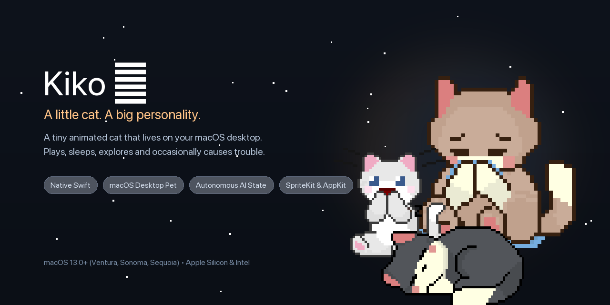
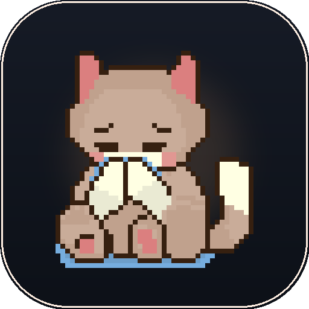

<div align="center">



<br/><br/>



# Kiko 🐈

**A little cat. A big personality.**

A native animated virtual desktop companion that lives on your macOS desktop.

Kiko explores your desktop, perches on application window title bars, stalks your cursor, discovers cardboard boxes, plays with toys, and exhibits lively, realistic feline behaviours.

<br/>

[](https://apple.com/macos)
[](https://swift.org)
[](LICENSE)
[](#installation)

</div>

---

## 🌟 Features

Kiko is built from the ground up as a native macOS application designed to feel like a real living creature living on your desktop.

### 🐾 Desktop Integration
- **Transparent, Borderless Window:** Borderless floating window (`NSPanel`) with `.floating` window level that stays visible above normal application windows.
- **Retina Crisp Rendering:** Native CoreAnimation pixel rendering with nearest-neighbor interpolation (`kCAFilterNearest`) so pixel art remains sharp on Retina displays.
- **Multiple Displays & Boundaries:** Automatically detects screen frames and corners; prevents the pet from falling off-screen.
- **Position Persistence:** Remembers last desktop coordinates across restarts via `UserDefaults`.

### 🪟 Application Window & Title-Bar Interaction
- **Quartz Window Server Detection:** Uses `CGWindowListCopyWindowInfo` to detect on-screen application windows (Safari, Terminal, Finder, Notes, Code, etc.).
- **Window Perching:** When near an open application, the cat can jump onto the window title bar, rest on the top edge, or walk along the ledge while you work.

### 🧠 Autonomous Behaviour Engine
- **17 Distinct States:** Finite State Machine with `IDLE`, `WALKING`, `RUNNING`, `PLAYFUL`, `CURIOUS`, `SLEEPING`, `HIDING`, `BOX_IDLE`, `STRETCHING`, `PLAYING`, `WATCHING_CURSOR`, `SURPRISED`, `EXCITED (ZOOMIES)`, `GRUMPY`, `INTERACTING`, `WINDOW_WATCHING`, and `DRAGGED`.
- **Dynamic Mood Engine:** 9 dynamic moods (*Happy*, *Sleepy*, *Curious*, *Playful*, *Grumpy*, *Excited*, *Bored*, *Scared*, *Relaxed*) that influence movement speed and decision weights.
- **Continuous Need Meters:** Tracks **Energy**, **Boredom**, and **Affection** with real-time decay and recovery.

### 🖱️ Cursor Interaction & Petting
- **Curious Stalking:** Turns head/body towards the cursor when within ~220px. Creeps forward playfully and pounces when close.
- **Petting Gestures:** Moving the cursor gently over the cat detects petting, plays purrs, emits floating hearts (`fx_heart.png`), and boosts affection.
- **Elastic Dragging & Stretching:** Picking the cat up applies elastic squash-and-stretch. Fast dragging triggers an animated wiggle flail, followed by a soft bounce landing on release.

### 📦 Cardboard Box System
- **Dedicated Desktop Fixture:** A draggable cardboard box window (`BoxWindow`) with multiple visual states (`empty`, `peeking`, `head_out`).
- **Inactivity Sleep:** When left unattended for > 2 minutes, the cat wanders over to its box, curls up inside, and falls asleep.
- **Peeking Eyes:** Moving the cursor near the box makes two glowing eyes peek out, prompting the cat to emerge.

### 🎮 Mini-Games & Toys
- **🔴 Laser Pointer:** High-intensity red laser dot that follows cursor; cat energetically chases and pounces on it.
- **🧶 Yarn Ball:** Bouncing yarn ball with real-time physics (velocity, gravity, restitution); cat bats it around the screen.
- **🦋 Butterfly Chase:** Spawns an animated fluttering butterfly that drifts across the desktop.
- **🐟 Fish Treat:** Drop a savory fish snack on the desktop for the cat to stalk, eat, and purr.

### 🎨 Multiple Cat Avatars
Switch seamlessly between 4 avatars with individual personalities and custom coat variations:
1. **Kiko:** Ginger Tabby — Energetic, curious, cuddly.
2. **Smokey:** Grey Tabby — Lazy, relaxed, loves sleeping.
3. **Kuro:** Midnight Void — Mischievous, quick, independent.
4. **Mochi:** Snow White — Playful, affectionate, sweet.

### 🔊 Retro Audio System
- Built-in sound effects: Meow, purr, chirp, pounce, snore, footstep.
- Full volume slider and mute controls.

### ⚙️ Preferences & Status Bar Menu
- Accessible from the macOS menu bar (`NSStatusItem`).
- Interactive SwiftUI Settings panel to customize avatar, cat name, scale, volume, and toggles.

---

## 🚀 Building & Running

### Requirements
- macOS 13.0 (Ventura) or newer (Sonoma & Sequoia fully supported)
- Apple Silicon (M1/M2/M3/M4) or Intel Mac
- Swift 5.9+ / Command Line Tools

### Build the Application
```bash
# Compile Kiko and all modules
swift build --product Kiko
```

### Launch Kiko
```bash
# Run Kiko on your desktop
swift run Kiko
```

### Run Automated Unit Tests
```bash
# Execute test suite (43 unit tests covering state machine, math, animations, moods)
swift run KikoTestRunner
```

---

## 🛠️ Project Architecture

```
valiant-hubble/
├── Package.swift                  # SPM manifest defining KikoCore, Kiko, and KikoTestRunner
├── README.md                      # Documentation & instructions
│
├── assets/
│   ├── audio/                     # Synthesized 16-bit WAV sound effects (meow, purr, chirp, etc.)
│   ├── branding/                  # Avatar, banner, and logo artwork
│   └── sprites/
│       ├── original/              # Original RetroCatsFree.png sprite sheet
│       └── processed/             # Sliced frames, box states, toys, and particle sprites
│
├── Sources/
│   ├── Kiko/                      # Application executable entry point
│   │   └── main.swift             # @main runner
│   │
│   └── KikoCore/                  # Core modular framework
│       ├── Animation/             # SpriteManager, SpriteAnimation, AnimationState
│       ├── App/                   # AppDelegate & menu bar setup
│       ├── Audio/                 # SoundManager & SoundEffect
│       ├── Behaviour/             # BehaviourEngine, BehaviourType, ActionPlanner, RandomEventManager
│       ├── Core/                  # CatAvatar, Personality, PetState, Mood, Constants
│       ├── Desktop/               # PetWindow, BoxWindow, WindowDetector, ScreenManager
│       ├── Interaction/           # InteractionManager, MiniGameManager, CursorFollower
│       └── Settings/              # Preferences & SettingsWindow (SwiftUI)
│
└── Tests/
    └── main.swift                 # Comprehensive unit test suite runner
```

---

## 📄 License & Attribution

- **Code:** Distributed under the **MIT License**. See [LICENSE](LICENSE).
- **Art Assets:** Original cat sprite sheet from the **"Cat Pack - Pochi"** collection by **ToffeeCraft** on [itch.io](https://toffeecraft.itch.io/cat-pack-pochi).
